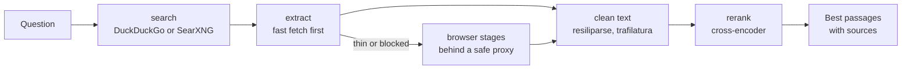

<p align="center">
  <picture>
    <source media="(prefers-color-scheme: dark)" srcset="assets/logo-dark.svg">
    
  </picture>
</p>

**Web search for AI agents, running on your own machine.** Ask a question and get back the
passages that answer it, with their sources. Search, clean page extraction and a fast
reranker in one small Python package. No API key needed: search runs over DuckDuckGo or
your own SearXNG instance, paid providers are an optional fallback.

```
$ python examples/answer.py "How much does the NVIDIA DGX Spark cost and how much memory does it have?"
1. How much does the NVIDIA DGX Spark cost? The Founders Edition launched at $3,999 in
   October 2025 and now lists for $4,699 on NVIDIA's marketplace after a ...
   gpusmith.com
2. The NVIDIA DGX Spark is a compact desktop AI computer (150mm x 150mm, 1.2kg) powered by
   the NVIDIA GB10 Grace Blackwell Superchip. It delivers 1 petaFLOP of ...
   www.aitooldiscovery.com
3. The NVIDIA DGX Spark is a palm-sized desktop AI computer built on the GB10 Grace Blackwell
   Superchip, with 128 GB of unified memory, 273 GB/s of bandwidth, and ...
   millionminer.com

searched and read 5 pages in 5.8 s, ranked 254 passages in 1.3 s
```

A price that changed after launch is exactly what a language model gets wrong from memory.
Searchify reads the live pages, ranks every paragraph against the question and returns the
best one per source. The core of [`examples/answer.py`](examples/answer.py):

```python
from searchify import search, extract, rerank

hits = search(question, max_results=8)                    # keyless web search
pages = extract([h["url"] for h in hits[:5]])             # clean text of the top pages
passages = [{"content": p, "url": page["url"]}            # one item per paragraph
            for page in pages for p in page["content"].split("\n")
            if len(p.split()) >= 12]
ranked = rerank(question, passages)                       # best paragraphs first
```

Run it once and the reranker model (about 470 MB) downloads; after that it is cached.

## Install

Not on PyPI yet, so install from GitHub:

```bash
pip install "searchify[rerank] @ git+https://github.com/sami-mag07/searchify-l"
```

| Extra | Adds |
|---|---|
| (none) | search and extraction |
| `rerank` | the cross-encoder reranker (`sentence-transformers`) |
| `api` | the HTTP service (`fastapi`, `uvicorn`) |
| `browser` | the browser stages for JavaScript and bot-protected pages (`playwright`) |
| `stealth` | the optional Camoufox stage |

Then set nothing and search works. Copy `.env.example` to `.env` only if you want a SearXNG
instance or a cloud fallback.

## What you get

| Call | What it does |
|---|---|
| `search(query)` | Web results as `{title, url, content, engine}`. DuckDuckGo by default, or your own SearXNG instance, with an optional cloud fallback. |
| `extract(urls)` | The clean article text of each page, without menus, footers or cookie banners. Starts with a fast fetch and only opens a browser when a page needs one. |
| `rerank(query, items)` | Reorders results or passages best-first with a multilingual cross-encoder (`mmarco-mMiniLMv2`). Point `RERANKER_MODEL` at your own model to swap it. |
| `POST /search`, `POST /extract` | The same as an HTTP service, see below. |

## Command line

```bash
searchify search "Where is the Eiffel Tower?"
searchify extract "https://en.wikipedia.org/wiki/Eiffel_Tower"
```

Output is JSON by default (`{"results": [...]}`, errors as `{"error": ...}` with exit code 1),
so agents and scripts can parse it. Add `--no-json` for a readable view. `search` takes
`-n`, `--backend`, `--language`, `--time-range`, `--include-domain` and `--exclude-domain`;
`extract` takes `--format text|markdown` and several URLs.

## How the research agent works

The package finds and reads pages. [`skill/`](skill/) turns it into a research agent: drop the
folder into Claude Code (or any agent with skills) and it researches the way a careful analyst
does.

1. **Every claim needs a checked source.** Each statement in the answer gets a source number
   and a verbatim quote, and `sources.py quote` only accepts the quote if it really appears in
   the page text. Before the answer counts as done, `sources.py verify` fails if any claim has
   no checked quote, and with `--numbers` also if a number in a sentence is not in its quotes.
   An invented fact or a changed figure stops the answer instead of reaching you.
2. **Sources are kept, not thrown away.** URLs and quotes stay in a ledger file, and every hit
   goes into a shared found-list (`--seen`). You can come back later, re-check every quote
   live (`verify --check-urls`) and continue the research where it stopped.
3. **Not just your words as typed.** The agent searches the question several ways: other
   languages, synonyms, the provider's and the participant's point of view, a broad and a
   niche term, filters like `site:` or the year. Duplicates are merged, and hits that several
   engines found rank higher. In our own test (9 research tasks, October 2026), three extra niche
   queries raised the share of known good sources in the top 30 from 18% to 23%.

The skill's own web search (`skill/references/search.py`) uses Tavily, Exa, Serper and Jina,
each only if you set its key (all have free tiers). Setup: [`skill/README.md`](skill/README.md).

## Benchmark

Run `final_2031`, 15 Oct 2026, 146 fresh pages (Wikipedia, GitHub, Hacker News, news,
bot-protected) against the top open-source scrapers on GitHub. Fresh means no page was seen
in an earlier run, so nobody serves it from cache. Scrapling is not included in this run.

**Quality (F1) per scraper**, higher is better:

```
searchify      84%  ████████████████▊   best
patchright     83%  ████████████████▌
trafilatura    82%  ████████████████▍
firecrawl      73%  ██████████████▌
crawl4ai       66%  █████████████▏
```

F1 is the balance of precision and recall of the extracted main text: it drops both when real
article text is missing and when boilerplate leaks in. Searchify leads on F1 and on the share
of pages it handles at all, while two tools (firecrawl, crawl4ai) are fast but let a lot of
boilerplate through, which is why their F1 is low despite a high raw hit rate.

**Full table:**

| Scraper | Handled | Hit | Clean | F1 | p50 | p95 | RAM |
|---|---:|---:|---:|---:|---:|---:|---:|
| **searchify** | **87%** | 91% | 84% | **84%** | 0.47 s | 5.00 s | 3751 MB |
| own baseline | 85% | 91% | 81% | 82% | 0.24 s | 1.30 s | 4364 MB |
| patchright | 80% | 88% | 85% | 83% | 1.80 s | 7.01 s | 2196 MB |
| trafilatura | 79% | 88% | 84% | 82% | 0.23 s | 0.86 s | 195 MB |
| firecrawl | 84% | 92% | 65% | 73% | 2.68 s | 8.79 s | 3947 MB |
| crawl4ai | 84% | 92% | 58% | 66% | 1.11 s | 3.44 s | 1995 MB |

What the columns mean:

- **Handled**: pages that returned usable content at all.
- **Hit**: pages where the expected text was found.
- **Clean**: how much of the output is real article text and not navigation or boilerplate.
- **F1**: the overall quality score (precision and recall combined).
- **p50 / p95**: median and 95th-percentile response time.
- **RAM**: peak memory. Searchify's figure includes the reranker that runs inside the same
  service (around 1 to 2 GB); the other tools have no reranker, so their RAM is not directly
  comparable.

**Bot-protected pages (the hard set)**, share handled, higher is better:

```
searchify      31%  ███████████████▌   best
own baseline   19%  █████████▌
firecrawl      19%  █████████▌
crawl4ai       15%  ███████▌
patchright      0%
trafilatura     0%
```

Static-only tools (trafilatura) and plain headless browsers (patchright, in this run) get nothing
on these pages. Searchify gets the most through because its last stage waits out the challenge
on a real browser behind the outbound proxy.

**Versus the previous own baseline:** cleaner output (+3), higher F1 (+2), and 500 to 600 MB less
RAM. The one regression is p95 (1.3 s to 5.0 s): blocked pages wait up to 6 seconds for the
Cloudflare challenge to resolve. That affects about 4% of pages and is a deliberate trade, since
the challenge only clears after roughly 5 seconds.

Rules kept during tuning: no captcha solving, no result gaming (never remove real text just to
raise a number), the safety limits never weakened. The run measured the default ladder below;
the optional Camoufox stage (`READER_STEALTH=1`) was not part of it.

## How it works



Every stage only runs when the previous one was not enough: most pages never open a
browser, and the browser stages only ever connect to public addresses on the normal web
ports. Details: [`docs/architecture.md`](docs/architecture.md).

## Search backends

| Backend | Key needed | Notes |
|---|---|---|
| `duckduckgo` | no | Default. Works immediately via the `ddgs` package. |
| `searxng` | no | Your own instance. Fast and private; set `SEARXNG_URL`. |
| `serper` | yes | Optional Google fallback. Off unless `SERPER_API_KEY` is set. |
| `tavily` | yes | Last safety net. Off unless `TAVILY_API_KEY` is set, and then only asked when every other backend found nothing. |

Choose the primary with `SEARCH_BACKEND` and a fallback with `SEARCH_FALLBACK`.
The default chain is local only: DuckDuckGo, then SearXNG if configured.

With `TAVILY_API_KEY` set, Tavily becomes the last step in two places: in search when
every backend came back empty, and in reading when every local stage (static fetch,
browser, Camoufox) failed on a page. When the local stack works, Tavily is never called.

```python
from searchify import search

# keyless, out of the box
hits = search("who makes solid-state batteries", max_results=10)

# your own SearXNG instance
hits = search("quarterly earnings tsmc", backend="searxng", time_range="month")

# restrict to domains
hits = search("transformer architecture", include_domains=["arxiv.org"])
```

## HTTP service

Run the service and send it web addresses, one or many at a time:

```bash
uvicorn searchify.service:app
curl -s http://localhost:8000/search  -H 'content-type: application/json' -d '{"query": "solid-state batteries"}'
curl -s http://localhost:8000/extract -H 'content-type: application/json' \
  -d '{"urls": ["https://en.wikipedia.org/wiki/Web_scraping",
                "https://en.wikipedia.org/wiki/Data_scraping"]}'
```

In Python:

```python
import requests

answer = requests.post(
    "http://localhost:8000/extract",
    json={"urls": ["https://en.wikipedia.org/wiki/Web_scraping"]},
)
print(answer.json())   # the clean text for each address
```

**How it decides how hard to try (the load ladder, `read_pages`):**

1. **Plain fetch** with httpx, falling back to curl_cffi when the site answers 403/429/503.
   The fast path.
2. A thin result (under 40 words, or under 300 with challenge text) counts as a miss and
   moves on.
3. **Shared browser**: one shared Chromium, all requests through the safety-checked proxy,
   3 slots, closes after 300 s idle. Reddit only works here.
4. **Direct browser**: a page in the same browser that loads through the outbound proxy
   (public addresses and the normal web ports only, address pinned), challenge wait 6 s,
   2 slots.
5. If every stage fails, the plain text is kept. At most 2 pages per request open a browser.

**Browser settings** (environment variables):

- `READER_RENDER=0` turns all browser stages off (plain fetch only).
- `RENDER_DIRECT=0` turns off stage 4 only.
- `RENDER_SLOTS`, `RENDER_DIRECT_SLOTS` set how many pages open a browser at once.
- `READER_STEALTH=1` with `CAMOUFOX_PYTHON` adds Camoufox as a last stage, at most once per
  request. Off by default.

The browser stages need `pip install "searchify[browser]"` and
`playwright install chromium-headless-shell`.

## Configuration

Every setting is optional and read from the environment (see `.env.example`):
`SEARCH_BACKEND`, `SEARCH_FALLBACK`, `SEARXNG_URL`, `SERPER_API_KEY`, `TAVILY_API_KEY`,
`RERANKER_MODEL`, `FETCH_TIMEOUT`. No key is ever read from code.

## Tests

```bash
pip install -e ".[dev,api]"
pytest
```

## Limits

- No own web index. Breadth depends on DuckDuckGo or the engines behind your SearXNG.
- DuckDuckGo rate-limits heavy use. For anything beyond a few queries a minute, run SearXNG.
- Bot-protected pages: 31% get through (see the benchmark). There is no captcha solving.
- The first `rerank` call loads the model, which takes a few seconds.

## License

MIT. See [`LICENSE`](LICENSE).
